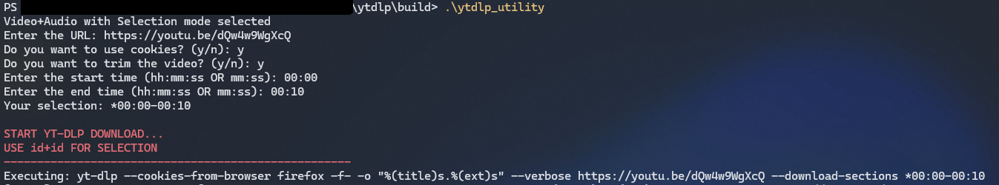
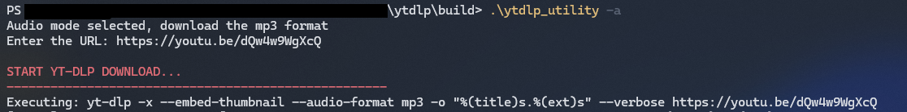

# Simple yt-dlp CLI Utility

A command-line utility to simplify and enhance video, audio, playlist and subtitle downloads using `yt-dlp`. 
This tool provides an interactive interface with **multiple download modes**, including support for cookies, trimming, playlists, and specific format selection. 
It will help you use `yt-dlp` **without needing to remember all the command-line options** for different download scenarios.

Learn more about `yt-dlp` at [yt-dlp GitHub](https://github.com/yt-dlp/yt-dlp).

## Features

- **Video Download**  
  Download a video from a site supported by `yt-dlp`, in best available format (only YT) or in a specified format.
- **Cookie Integration**  
  Use cookies from your Firefox browser for accessing private or age-restricted video.
- **Trim Specific Sections**  
  Download only a portion of a video using time ranges (e.g., `00:30:00-00:45:00`).
- **Embedded Subtitles**  
  Add subtitle tracks (manual or auto-generated) directly into the downloaded video, also when trimming.
- **Audio-Only (MP3)**  
  Extract audio as MP3 with embedded thumbnail.
- **Playlist Support**  
  Download entire playlists with optional numbering (e.g., `1-title.mp3`, `2-title.mp3`).
- **Subtitles Download**  
  Fetch subtitles in SRT format, including auto-generated captions.

## Example of usage

- Download the first 10 seconds of a video using cookies and selecting a specific format.



- Download only the audio of a video in MP3 format and with a thumbnail.
  


## Requirements

- `yt-dlp` (Remember to always use the latest version)
- `FFmpeg`
- `make` for building the executable ([Windows version](https://gnuwin32.sourceforge.net/packages/make.htm)).
- `Python` if you want to run the script directly without compiling.

## Compiling

In the main repo directory run the following command to build the executable:

```bash
make 
```
This will create an executable named `ytdlp_utility` in the build directory.

Or you can run the script in the src folder directly with Python:

```bash
pip install yt-dlp
python ytdlp_utility.py
```
The usage is the same as the compiled version.

## Usage

Once you have the executable or the python script, you can run it with some option. The downloaded file or folder will be in the same directory of the executable.
Remember to provide an url supported by `yt-dlp` (e.g., YouTube, Vimeo, etc.).

## Video and audio download

- Video and audio download with custom format selection:

```bash
.\ytdlp_utility
```
Later you can decide to use cookies for authentication, trim the video and embed subtitles. Only firefox cookies are supported at the moment.
This will download the file in the specific format you choose.


- Video and audio download with best mp4+m4a only supported by YT, may not work on all sites:

```bash
.\ytdlp_utility --best
```
Later you can decide to use cookies for authentication, trim the video and embed subtitles.
This will download the file in the best available mp4+m4a format.

### Embedded subtitles

As last option you can embed subtitles in the video: enter the languages (e.g. `it,en`) or press ENTER for the auto-generated ones in the original language.
The final file will contain one subtitle track per language (mp4 and mkv; webm videos are saved as mkv, since webm only supports WebVTT subtitles).

When the video is trimmed, the subtitles are cut and aligned to the selected section.
Without re-encoding the cut starts at the previous keyframe: mp4 hides this extra part, mkv keeps it (the video may start a few seconds earlier), and the subtitles are aligned to it.


## Audio-only download (MP3):

```bash
.\ytdlp_utility -a
```

This will download the audio in MP3 format with an embedded thumbnail.

## Playlist download

```bash
.\ytdlp_utility -p
```

Than choose between these 4 option:

1) Audio mode (mp3) with enumeration (1-NameVideo1.mp3 2-NameVideo2.mp3...)
2) Audio mode (mp3) without enumeration
3) Video+Audio mode (best mp4+m4a) with enumeration (1-NameVideo1.mp4 2-NameVideo2.mp4...)
4) Video+Audio mode (best mp4+m4a) without enumeration

Where enumeration means that the files will be named with a number prefix (e.g., `1-Title.mp3`) representing their order in the playlist, and best mp4+m4a means that it will work on YouTube and may not work on other sites.

Disclaimer: I'have not tested the playlist download on all sites, it will work with YT but it may not work with other sites.

## Subtitles download

```bash
.\ytdlp_utility -s
```

You will be asked whether to use cookies (from Firefox) and for the subtitle languages (e.g. `it,en`). Cookies are recommended for auto-translated subtitles, which YouTube often blocks with `HTTP 429` otherwise. If one language fails, the others are still downloaded. Manual subtitles are preferred, auto-generated ones are used as fallback.
Pressing ENTER downloads all manual subtitles plus the auto-generated captions in the video's original language. All files are saved in SRT format.

